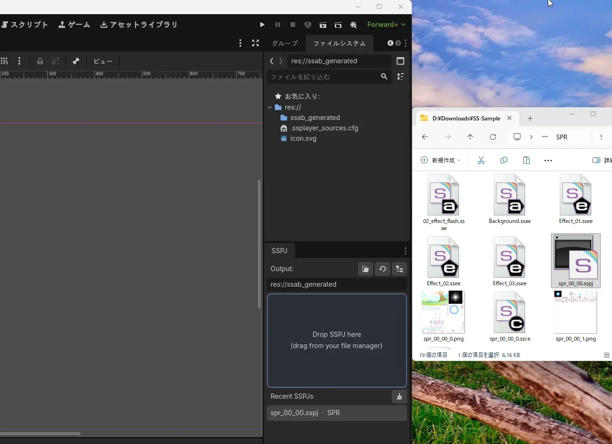
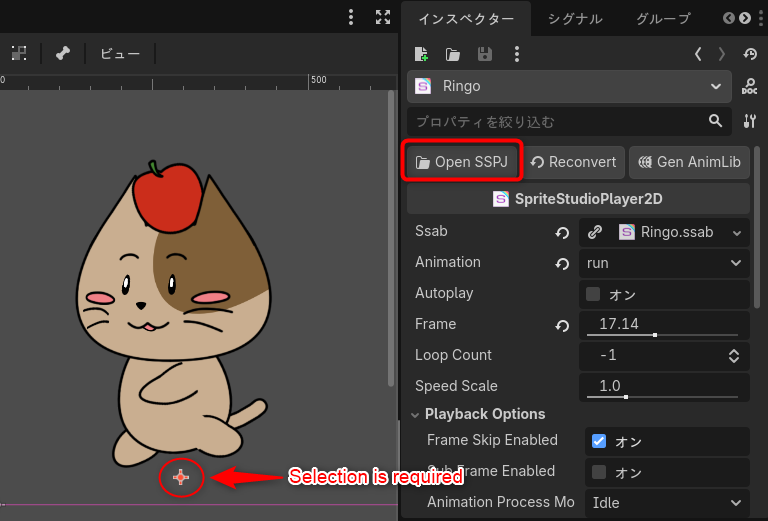
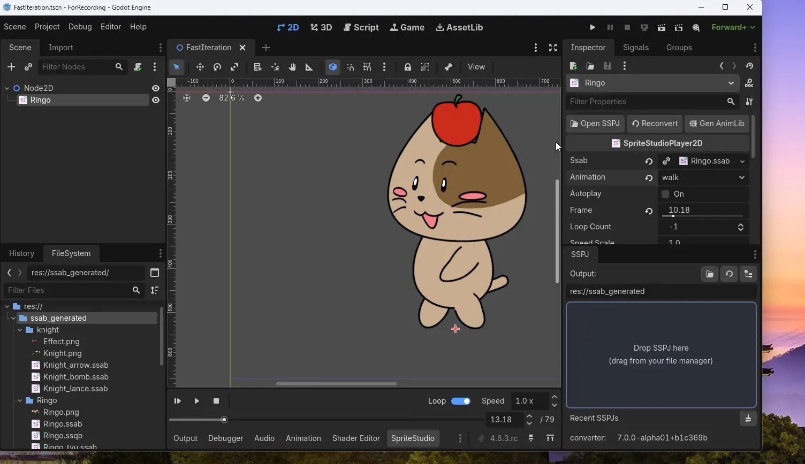

# 🗂️ Asset Import and Editor Integration

This page explains **how to bring your `.sspj` into a Godot project (the initial conversion)** and the workflows for iterating quickly between SpriteStudio and Godot afterwards.

Besides playing animations, SpriteStudio Player for Godot lets you move between SpriteStudio and Godot as you iterate, from tweaking an animation to seeing it in the game.

---

## 1. Initial Import (Converting via the SS Importer dock)

If there is no `.ssab` in your Godot project yet, you first need to import (convert) the SpriteStudio project file (`.sspj`).

1. Open the **"SS Importer" dock** on the right side of the Godot editor.
2. Check the output directory (default is `res://ssab_generated`).
3. **Drag and drop the `.sspj` file** from your Explorer/Finder into the "SS Importer" dock.

This triggers the conversion process. The `.ssab` and `.ssqb` files, with the textures beside them, are written to a folder named after the `.sspj` in the output directory — `res://ssab_generated/Ringo/` for `Ringo.sspj` (see [Generated Assets and Packs](generated_assets.md)).
Drag and drop the generated `.ssab` file into the 2D viewport to place a `SpriteStudioPlayer2D` node in advance (see [Basic Usage](usage_basic.md) for details).

> [!TIP]
> 
> <video autoplay loop muted playsinline width="100%">
>   <source src="../assets/1-sspj_import.webm" type="video/webm">
> </video>
> 

> [!TIP]
> If you do not have a `.sspj` yet and just want to try this out, the [official SpriteStudio sample data](https://www.webtech.co.jp/help/ja/spritestudio7/download/sample/) works as-is (that page is only available in Japanese; the downloads themselves are language-neutral). [Ringo](https://www.webtech.co.jp/help/ja/spritestudio7/download/sample/#ringo) is a good character sample, and [Particle](https://www.webtech.co.jp/help/ja/spritestudio7/download/sample/#Perticle_sample) is a good one if you want effects. Drop the downloaded `.sspj` onto the "SS Importer" dock exactly as described above.

---

## 2. Opening SpriteStudio Directly from Godot

When working in Godot and feeling the need to tweak an animation, you don't have to launch SpriteStudio separately and search for the project.

1. Select the **`SpriteStudioPlayer2D` node** playing the animation in the Godot editor.
2. Click the **"Open SSPJ" button** shown at the top of the Inspector.

This action automatically launches SpriteStudio and opens the underlying `.sspj` file, allowing you to start editing immediately.

> [!NOTE]
> 

---

## 3. Reconverting After Saving in SpriteStudio

After modifying and saving the animation in SpriteStudio, return to the Godot editor.
With just the following steps, your changes will instantly reflect in the game (and in the editor preview).

1. As before, select the node to show the Inspector.
2. Click the **"Reconvert" button** next to the "Open SSPJ" button.

> [!IMPORTANT]
> **The shortest workflow: "Open" -> "Save" -> "Reconvert"**
> You can call SpriteStudio directly from the Inspector with the node selected, and immediately reconvert in Godot after editing.

> [!TIP]
> 
> <video autoplay loop muted playsinline width="100%">
>   <source src="../assets/2-fast_iteration_inspector.webm" type="video/webm">
> </video>
> 

> [!TIP]
> What each file in the output folder does, how they depend on each other, which of them you have to re-ship after each kind of edit, how to choose an export mode, and how to ship updates as a `.pck` are collected in [Generated Assets and Packs](generated_assets.md).

---

## Limitations and Team Development Notes

`Open SSPJ` and `Reconvert` have some limitations. Keep them in mind, especially when working in a team.

> [!WARNING]
> **SpriteStudio installation is required**
> Clicking the "Open SSPJ" button will launch SpriteStudio. Therefore, [SpriteStudio](https://www.webtech.co.jp/spritestudio/) must be installed on the PC you are using.

> [!TIP]
> **File Path Sharing and Smart Re-link for Team Development**
> 
> When you import using the SS Importer dock, the integration information (the file path to the `.sspj`) is saved as a **relative path** inside the `.ssplayer_sources.cfg` file located at the root of your Godot project.
> 
> By tracking `.ssplayer_sources.cfg` in a version control system like Git, team members can `git clone` the project and immediately use the `Open SSPJ` and `Reconvert` buttons, as the paths remain valid across different PCs.
> 
> Furthermore, if the `.sspj` file is moved and the link breaks, it is easy to fix. Right-click the broken `.ssab` in the FileSystem dock and select "Reconvert". You will be prompted to locate the new `.sspj` location. By re-linking just one file, all other related files in the same directory will be **automatically and smartly re-linked**, minimizing manual repair efforts.
